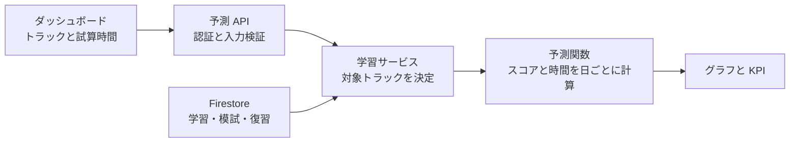

# MiraiStudy の設計とコードの読み方

MiraiStudy は、学習テーマごとに目標、学習時間、模試結果、開発実績、復習カードを管理する。学習ペースを変えた場合の予測を表示し、AI ROZA Hub からは SSO と学習サマリー照会を提供する。API の全一覧、データ項目、計算条件は [詳細設計書](./detailed-design.md) に記載している。

## 設計原則をこのコードで読む

- **共通の構成を使い、計算のルールを独立させる。** 実装計画は MiraiBody の Nuxt／GCP 構成を横展開する方針を記録している。MiraiStudy の予測・復習ルールは `shared/domain/simulation.ts` にあり、Firestore のパスや HTTP 入出力を知らずに計算できる。将来変わる知識をモジュール内に収める情報隠蔽の考え方に沿う。 [実装計画](./implementation-plan.md) · [Parnas のモジュール分割論文](https://dl.acm.org/doi/10.1145/361598.361623)
- **機能を入口から追う。** 画面で起きる操作、サーバーに渡す引数、DB または外部サービスへのアクセス、返ってきた値の表示を順に確かめる。全体・内部モジュール・コードで粒度を変えると見通しがよい。 [C4 モデル](https://c4model.com/)
- **計画と現在のインターフェースを見分ける。** たとえば実装計画には Hub 向けの QuickSheet と書き込みが登場する。現在の Hub が利用する同期照会は署名付き Agent Card の `study_summary` から追える。採用時の背景や影響を残す文書の形式には ADR（Architecture Decision Record）がある。 [Agent Card](../server/routes/.well-known/agent-card.json.get.ts) · [ADR の原典](https://cognitect.com/blog/2011/11/15/documenting-architecture-decisions)

## フォルダと実行場所

```text
pages/                 ダッシュボード、履歴、画像取込、ログイン
  auth/sso/            Hub から戻る画面
components/            目標・記録フォーム、復習カード、予測グラフ
composables/           認証状態、API 呼び出し、画像準備、画面データ
layouts/               ページ共通の表示枠
middleware/            画面遷移時のログイン確認
server/
  api/                 /api 配下の HTTP ハンドラー
    auth/sso/          SSO 開始とコード消費
    ingest/            画像解析と一時画像の削除
    reviews/           復習結果の保存
    a2a/               Hub 向け照会と互換タスク API
  routes/.well-known/  署名付き Agent Card
  domain/              記録の読み書き、集約、外部書き込みの下書き
  utils/               Firebase Admin、認証、画像検証、OpenAI API
shared/
  schemas/             対象トラックや入力・出力のデータ形式
  domain/              日次予測と復習間隔の計算
tests/                 スキーマ、予測、画像、SSO・A2A のテスト
scripts/               Cloud Run デプロイ用スクリプト
```

Nuxt のファイル規約では `pages/logs.vue` が `/logs`、`server/api/study-sessions.post.ts` が `POST /api/study-sessions` になる。 `composables/useDashboard.ts` は選択中のトラックや予測の画面状態をまとめる。API は検証済み UID の下にある Firestore コレクションを操作する。 [Nuxt 3 のサーバーフォルダ](https://nuxt.com/docs/3.x/directory-structure/server) · [Nuxt 3 の shared](https://nuxt.com/docs/3.x/directory-structure/shared) · [取得処理](../composables/useDashboard.ts) · [学習サービス](../server/domain/miraistudy-service.ts)

## フレームワークと主要な依存関係

| 技術 | このリポジトリでの役割 | 確認する場所 |
| --- | --- | --- |
| Nuxt 3、Vue 3、Vue Router | ファイルから画面と API を登録する。Vue がフォーム・選択状態・リアクティブなグラフ更新を扱う | [設定](../nuxt.config.ts) · [ダッシュボード](../pages/index.vue) |
| Nitro、h3 | Nuxt のサーバー実行基盤と HTTP ハンドラーの補助ライブラリ。JSON・multipart の読み取り、クエリやルート引数の取得、HTTP エラーに使う | [Vision API](../server/api/ingest/vision.post.ts) · [復習評価 API](../server/api/reviews/grade.post.ts) |
| TypeScript、Zod | TypeScript がコード内の型を検査し、Zod が API に届いた実データを検査する。スキーマから型を導出する | [模試スキーマ](../shared/schemas/exam-log.ts) · [Zod](https://zod.dev/basics) |
| Firebase JS SDK、Firebase Admin SDK | ブラウザの認証とサーバーでのトークン検証・Firestore／Cloud Storage 操作 | [ブラウザ側](../composables/useFirebaseAuth.ts) · [サーバー側](../server/utils/firebase-admin.ts) |
| Chart.js、vue-chartjs、Tailwind CSS | Vue から Chart.js の予測系列を描画し、ユーティリティクラスで画面を構成する | [予測グラフ](../components/FutureSimulatorChart.vue) · [Nuxt 設定](../nuxt.config.ts) |
| OpenAI API と標準 `fetch` | Chat Completions に画像を渡し、指定形式で解析結果を受け取る。学習予測と復習期日はコード内で計算する | [Vision クライアント](../server/utils/openai.ts) · [予測計算](../shared/domain/simulation.ts) · [OpenAI Structured Outputs](https://developers.openai.com/api/docs/guides/structured-outputs) |
| Vitest、ESLint、vue-tsc | ユニットテスト、静的ルール、Vue テンプレートの型チェック | [依存とコマンド](../package.json) · [テスト](../tests) |

## 機能からコードをたどる

| 機能 | 入口と実装されている処理 | コード |
| --- | --- | --- |
| ログイン・Hub SSO | 開始 API が state を Cookie に保存する。消費 API が署名と state を検証し、Hub メールを既存 Firebase UID に対応付け、カスタムトークンを発行する | [開始](../server/api/auth/sso/start.get.ts) → [消費](../server/api/auth/sso/consume.post.ts) → [アカウント対応](../server/utils/hub-account-mapping.ts) → [SSO テスト](../tests/sso.test.ts) |
| 学習トラック | 目標フォームが日付・目標点・学習時間等を送信する。 `upsertStudyTrack` が新規と更新を判断し、既定の変更をまとめて書き込む | [目標フォーム](../components/TrackGoalsForm.vue) → [PUT](../server/api/tracks.put.ts) → [学習サービス](../server/domain/miraistudy-service.ts) |
| 学習・模試・開発の記録 | 履歴画面が操作ごとに別の POST を呼び、サーバーはトラック ID の形式と入力項目を検証し、認証済み UID の下に保存する。GET はトラックで絞り込み、日付順に返す | [履歴画面](../pages/logs.vue) · [学習](../server/api/study-sessions.post.ts) · [模試](../server/api/exam-logs.post.ts) · [開発](../server/api/dev-logs.post.ts) |
| 学習予測 | `getStudySimulationForUser` がトラックと実績を取り出し、`runStudySimulation` に渡す。予測結果はスコアと累計時間の系列になり、グラフに渡る。スライダーは試算値を API に送り、トラック設定の保存は PUT が担う | [ダッシュボード取得](../composables/useDashboard.ts) → [予測 API](../server/api/simulation.get.ts) → [シミュレーション](../shared/domain/simulation.ts) → [テスト](../tests/simulation.test.ts) |
| 復習キュー | 該当トラックのカードを期日順に取得し、当日以前の active カードを表示する。評価の POST が `gradeReviewItem` を呼び、現在ステージから次回日と状態を計算して更新する | [復習カード](../components/ReviewQueueCard.vue) → [一覧](../server/api/reviews.get.ts) → [評価](../server/api/reviews/grade.post.ts) → [間隔の計算](../shared/domain/simulation.ts) |
| 画像からの記録 | Vision API が指定された画像種別に応じた出力スキーマを使い、解析成功後に画像を保存する。確認操作で、模試結果は模試と復習候補、教材は見積時間がある場合の学習ログと復習候補、タイマーは学習ログに変換する | [画像取込画面](../pages/ingest.vue) → [Vision API](../server/api/ingest/vision.post.ts) → [出力スキーマ](../shared/schemas/vision.ts) |
| Hub からの学習照会 | 署名付き Agent Card を取得し、ユーザー代理の Bearer で `SendMessage` を呼ぶ。Firestore の記録とローカル計算結果から同期サマリーを返す | [Agent Card](../server/routes/.well-known/agent-card.json.get.ts) → [A2A API](../server/api/a2a/v1.post.ts) → [契約テスト](../tests/a2a.test.ts) |
| 互換タスク API | 書き込みフラグとスコープを検査する。下書きの確定・取消を扱い、確定時に記録を保存してからタスク状態を更新する | [確定](../server/api/a2a/tasks/%5Bid%5D/commit.post.ts) · [取消](../server/api/a2a/tasks/%5Bid%5D/cancel.post.ts) · [下書きサービス](../server/domain/record-task.ts) |

### 学習予測のデータの流れ



## 用語とレビュー時の着眼点

| 用語 | このアプリでの意味 |
| --- | --- |
| トラック／KPI | トラックは「資格試験」など学習のまとまり。KPI は累計学習時間・予測スコアのように画面で追う指標 |
| What-if／OLS | What-if は日次学習時間を仮に変える試算。OLS（最小二乗法）は日付と模試スコアの点から変化の傾きを推定する |
| 収穫逓減／定着率ペナルティ | スコアが高くなると同じ学習時間による上昇が小さくなる。期限切れの復習はモデル上の定着率に反映する |
| 復習ステージ | 繰り返し復習するための間隔の段階。評価に応じて `nextReviewDate` と `active`／`mastered` を更新する |
| UTC 日付 | タイムゾーン差を避けるために計算で使う協定世界時の日付。期日境界を読むときは `todayIsoUtc` を見る |
| Vision／OCR／Structured Outputs | 画像解析、画像内文字の読み取り、AI 出力をスキーマの形に制約する機能。解析結果は記録の候補として扱う |
| SSO／A2A／Agent Card | 共通ログイン、システム間のエージェント通信、その接続先・対応機能を示す文書 |
| バッチ／トランザクション | バッチは複数の書き込みをまとめる。トランザクションは読み取った状態に基づく書き込みも一まとまりにする。2つの HTTP リクエストを順に呼ぶ操作では、片方だけ成功することがある |

AI が作成・修正した箇所は、操作から保存までの経路で読む。画像取り込みでは `handleSaveAnalysis` が種類ごとに複数 API を順に呼ぶ場合があるため、成功画面だけでなく途中失敗と再試行時の保存状態を確認する。復習の変更は `gradeReviewItem` の読み書きと `computeNextReviewSchedule` の日付・ステージ境界を両方見る。 [画像取込画面](../pages/ingest.vue) · [学習サービス](../server/domain/miraistudy-service.ts) · [Firestore のバッチとトランザクション](https://firebase.google.com/docs/firestore/manage-data/transactions) · [Google のコードレビュー観点](https://google.github.io/eng-practices/review/reviewer/looking-for.html) · [GitHub の AI 生成コードのレビュー](https://docs.github.com/en/copilot/tutorials/review-ai-generated-code)
